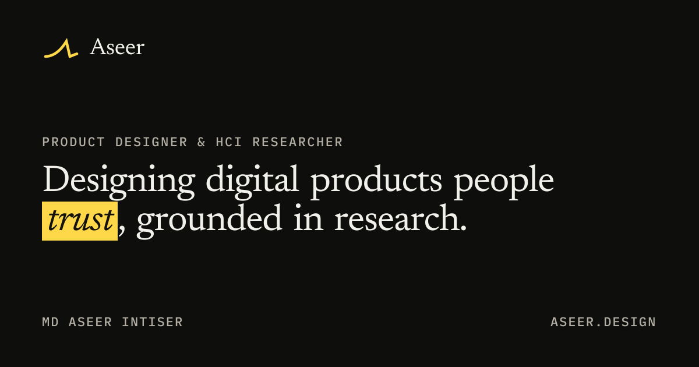
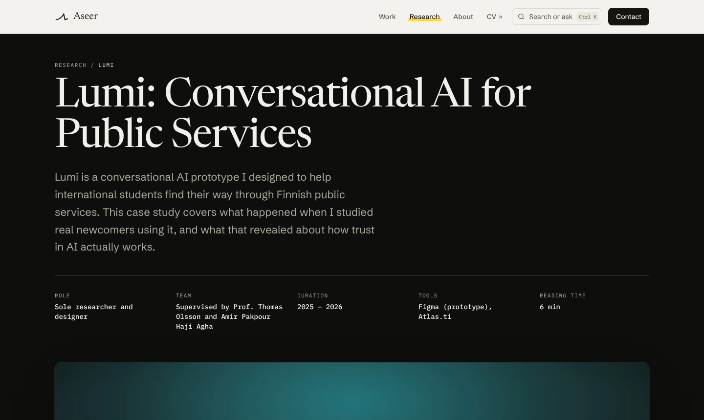
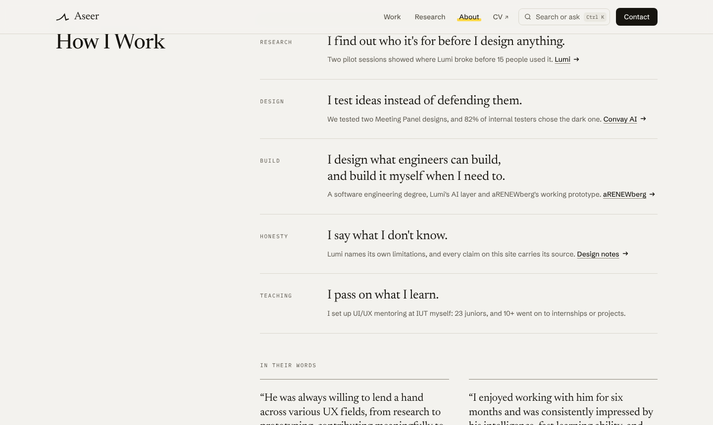
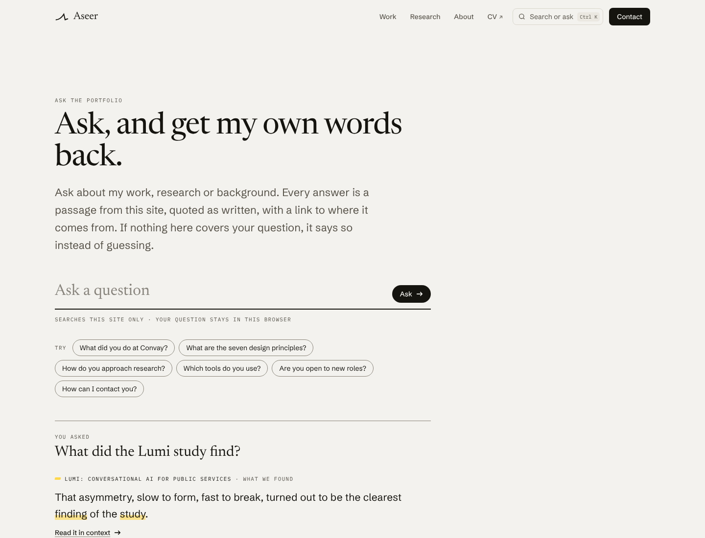

<p align="center">
  <a href="https://aseer.design">
    
  </a>
</p>

# aseer.design

The source code of [aseer.design](https://aseer.design), the portfolio of **Md Aseer Intiser**, a product designer and HCI researcher based in Finland. It holds his case studies, research and writing. He designed the site and built it himself.

**[Visit the site](https://aseer.design)** · [Work](https://aseer.design/work) · [Research](https://aseer.design/research) · [About](https://aseer.design/about) · [Ask the portfolio](https://aseer.design/ask) · [Design notes](https://aseer.design/design-notes)

<table>
  <tr>
    <td width="33%"></td>
    <td width="33%"></td>
    <td width="33%"></td>
  </tr>
  <tr>
    <td align="center"><sub>Case studies with numbered chapters</sub></td>
    <td align="center"><sub>About: how he works, with proof</sub></td>
    <td align="center"><sub>Ask the portfolio</sub></td>
  </tr>
</table>

## Contents

- [What's inside](#whats-inside)
- [Tech stack](#tech-stack)
- [Getting started](#getting-started)
- [Project structure](#project-structure)
- [Editing content](#editing-content)
- [Accessibility](#accessibility)
- [Performance](#performance)
- [Privacy](#privacy)
- [Deployment](#deployment)
- [Credits](#credits)
- [License](#license)
- [Contact](#contact)

## What's inside

- **Case studies** for industry work (Convay, an enterprise video conferencing platform) and research (Lumi, a conversational AI for public services). Each one opens with an "In short" summary, then runs in numbered chapters with a chapter rail.
- **An evidence layer.** Key claims in the featured case studies are marked and numbered. On wide screens their sources sit in the margin as sidenotes; on smaller screens they open as a card.
- **Project films.** Every project has a short trailer made only from its real screens (see [`scripts/trailers`](scripts/trailers/README.md)). The films loop quietly, and one switch in the footer pauses all motion on the site.
- **Ask the portfolio.** Visitors can ask a question and get back a passage from the site, quoted as written, with a link to where it comes from. If nothing on the site covers the question, it says so. The index is built at build time and ranked in the browser, so no question ever leaves the page.
- **A command bar** (`Ctrl K` or `⌘K`) for search, pages, printing and display options.
- **A color-vision view** that shows the site in grayscale or as people with deuteranopia, protanopia or tritanopia see it, plus an interactive colorblindness figure on the About page.
- **Print styles.** Case studies print as clean documents, with the claim sources listed at the end.
- **Generated share images** for every page, made at build time from the same type and colors as the site.

The reasoning behind the identity, the decisions and the measured results is written up on the [design notes](https://aseer.design/design-notes) page.

## Tech stack

| Area | Choice |
| --- | --- |
| Framework | [Next.js 16](https://nextjs.org/) (App Router). Every page is statically generated. |
| Language | TypeScript, strict mode |
| UI | React 19 |
| Styling | Tailwind CSS 4, with the design tokens in [`src/app/globals.css`](src/app/globals.css) |
| Motion | [Motion](https://motion.dev/), with reduced-motion settings respected everywhere |
| Fonts | Newsreader, Schibsted Grotesk and IBM Plex Mono, self-hosted through Fontsource |
| Search | A static index and BM25 ranking in the browser. No API, no external service. |
| Hosting | [Vercel](https://vercel.com/) |
| Analytics | [Umami](https://umami.is/), cookieless, production only |

## Getting started

You need [Node.js](https://nodejs.org/) 20.9 or newer (the minimum for Next.js 16) and npm.

```bash
git clone https://github.com/aseerintiser/aseer-design.git
cd aseer-design
npm install
npm run dev
```

Then open [http://localhost:3000](http://localhost:3000).

| Command | What it does |
| --- | --- |
| `npm run dev` | Starts the development server |
| `npm run build` | Builds the production site and generates every page |
| `npm run start` | Serves the production build locally |
| `npm run lint` | Runs ESLint |

### Environment variables

The site runs without any. One is optional:

| Variable | Purpose |
| --- | --- |
| `NEXT_PUBLIC_UMAMI_WEBSITE_ID` | Turns on Umami analytics. Set only in production on Vercel, so local and preview builds load no analytics. |

## Project structure

```
src/
  app/                  Routes (App Router)
    page.tsx              Home
    work/, research/      Indexes and case studies ([slug])
    about/, resume/       About and the CV page
    ask/                  Ask the portfolio, plus index.json, its search index built at build time
    design-notes/         How the site was designed and tested
    articles/, testimonials/, certifications/, design-showcase/
    opengraph-image.tsx   Share images
    sitemap.ts, robots.ts
  components/
    layout/               NavBar, Footer, Section, Container, SkipLink
    ui/                   Shared building blocks: Heading, Button, CommandBar, Lightbox, VisionView, ...
    case-study/           Case study layout, chapters, evidence layer, figures and players
    home/, about/, ask/, research/, work/, ...   Page-specific components
  content/              All copy and data, typed (projects, home, about, site, ...)
  lib/                  Ask engine, motion and vision preferences, fonts, utilities
public/
  media/framer/         Original project images, self-hosted
  trailers/, loops/     Project films and their posters
  lumi/, arenewberg/, robocarnival/, ...   Images for individual projects
scripts/
  trailers/             Builds the project films from real screens
  self-host-framer-images.*   One-off migration of images from the old site
docs/readme/            Images used in this README
```

## Editing content

There is no CMS. Everything a visitor reads lives in typed files in [`src/content`](src/content):

- `projects.ts` holds every case study as a list of content blocks (paragraphs, images, figures, callouts), plus each project's summary, metadata and claim sources.
- `home.ts`, `about.ts` and `site.ts` hold the homepage, the About page and site-wide details such as the email address, status line and social links.
- In case study text, `[[claim text|claim-id]]` marks a claim for the evidence layer. The matching source goes in that project's `claims`.

The Ask the portfolio index is rebuilt from these files on every build, so content changes need no extra step. Facts on the site come from the author's own records. Please don't change numbers without a source.

## Accessibility

Accessibility is part of every page, not a final pass.

- Lighthouse scores 100 for accessibility and 100 for best practices on the main pages (home, Work, About, Ask, design notes, the CV page, and the Convay AI, Convay Mobile, Lumi and aRENEWberg case studies), measured in October 2026.
- Semantic HTML, one `h1` per page, a skip link, visible focus states, and full keyboard access, including the command bar, lightbox and interactive figures.
- Color contrast meets WCAG AA, and color is never the only signal. The highlighter yellow always sits behind dark text.
- Reduced-motion settings are respected, and the footer switch stops every looping film (WCAG 2.2.2).

## Performance

- Every page is static and served from Vercel's edge.
- Measured with Lighthouse (mobile, devtools throttling) in October 2026: home 93, About 95, Ask 96. Layout shift is 0 on all three.
- Images are served through Next.js in modern formats. Films are short MP4 loops with WebP posters, which replaced GIFs of up to 47 MB.
- Fonts, images and films are self-hosted. In production, the only third-party service the site loads is Umami analytics.

## Privacy

- Analytics come from Umami, which sets no cookies and collects no personal data. It runs only on the production site.
- Questions typed into Ask the portfolio are searched inside the browser. They're never sent anywhere, and they never appear in a URL.

## Deployment

The site deploys to Vercel. A push to `main` goes live on [aseer.design](https://aseer.design), and other branches get preview URLs. The site as it was before the 2026 redesign is kept on the `previous-design` branch.

Old links from the earlier version of the site redirect to their new pages (see [`next.config.ts`](next.config.ts)).

## Credits

- Typefaces: [Newsreader](https://fonts.google.com/specimen/Newsreader) by Production Type, [Schibsted Grotesk](https://fonts.google.com/specimen/Schibsted+Grotesk) by Schibsted, and [IBM Plex Mono](https://fonts.google.com/specimen/IBM+Plex+Mono) by IBM, all under the SIL Open Font License.
- Built on [Next.js](https://nextjs.org/), [React](https://react.dev/), [Tailwind CSS](https://tailwindcss.com/) and [Motion](https://motion.dev/).

## License

All rights reserved. This repository is public so the code can be read and reviewed, but no license is granted to reuse it.

The writing, case studies, research, films and photos are © Md Aseer Intiser. Screens from employer and client projects remain the property of their owners.

## Contact

**Md Aseer Intiser**, product designer and HCI researcher

- Email: [md.aseerintiser@gmail.com](mailto:md.aseerintiser@gmail.com)
- LinkedIn: [md-aseer-intiser](https://www.linkedin.com/in/md-aseer-intiser/)
- Portfolio: [aseer.design](https://aseer.design)
